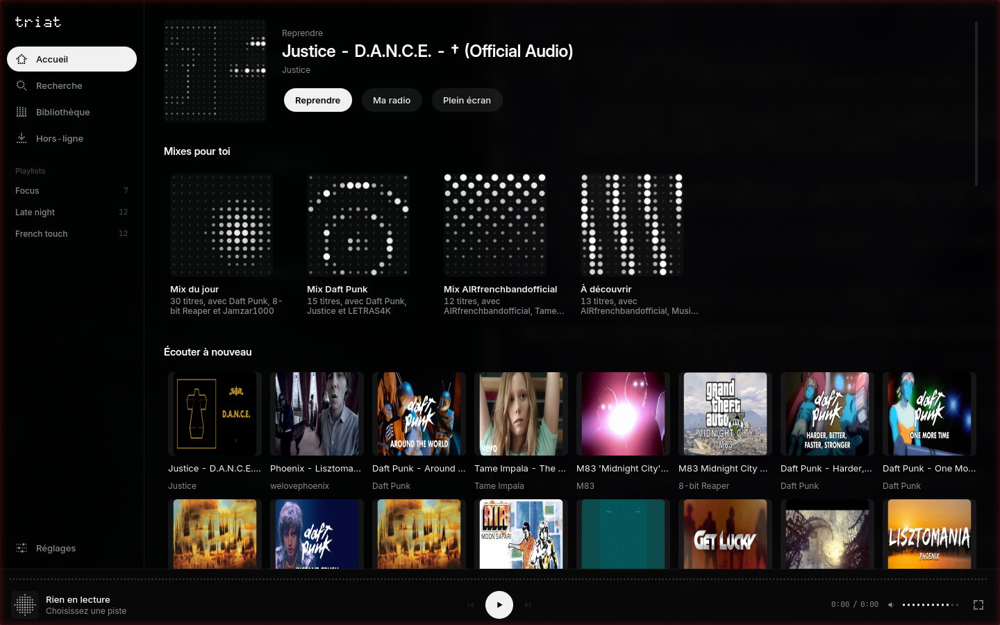
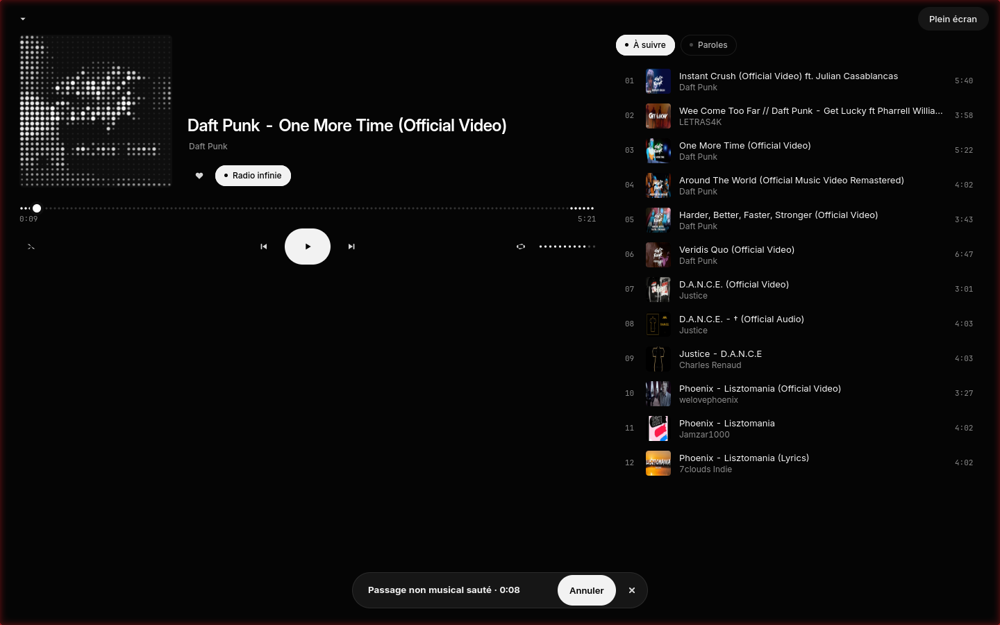
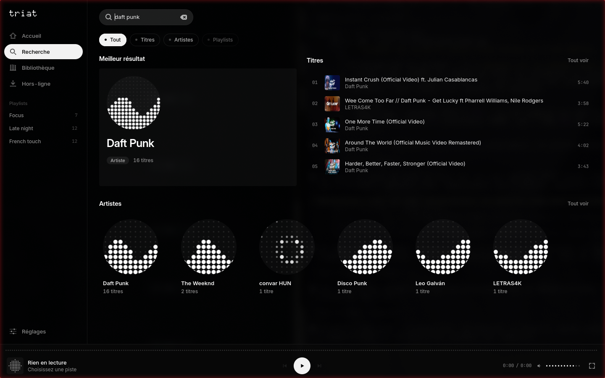
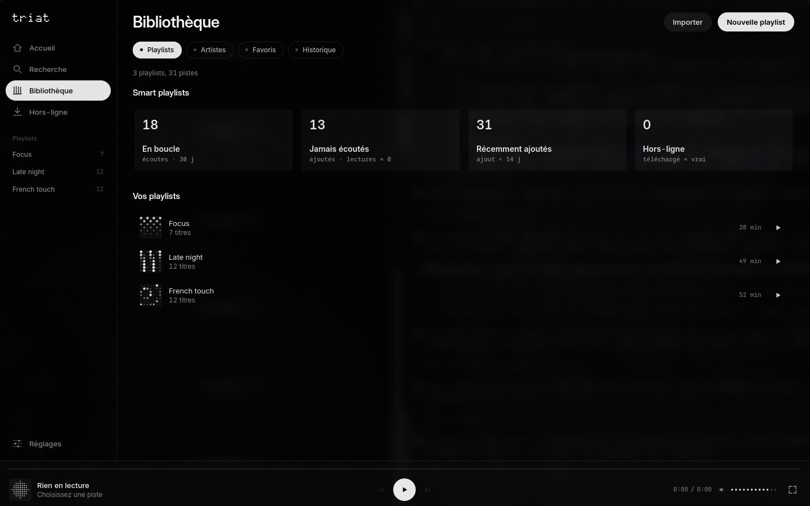
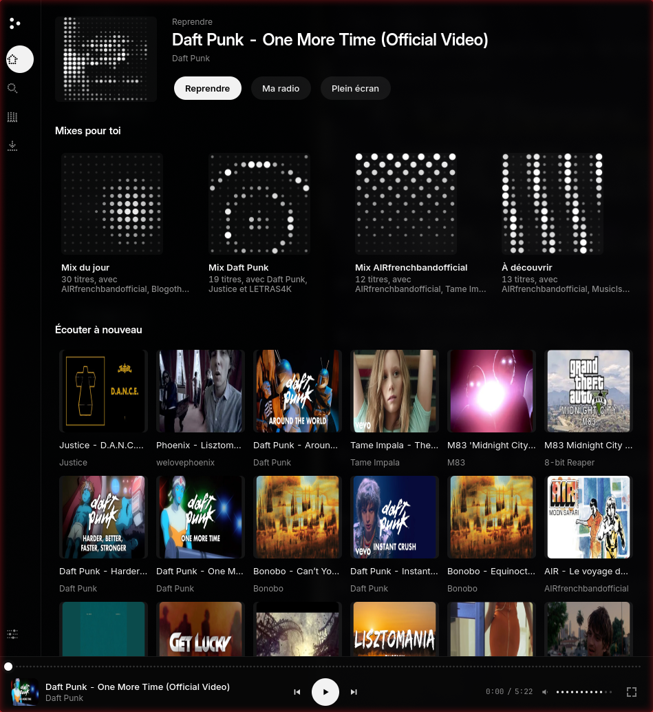

<p align="center">
  
</p>

<h1 align="center">Triat</h1>

<p align="center">
  <a href="README.md">English</a> | Français
</p>

<p align="center">
  Un lecteur de musique calme pour Linux, qui lit depuis YouTube, garde ta bibliothèque sur ton ordinateur et n'envoie rien sur toi nulle part.
</p>

<p align="center">
  <a href="LICENSE"></a>
  
  <a href="https://github.com/kerstz/triat-android"></a>
  <a href="https://kerstz.github.io/triat/"></a>
</p>

<p align="center">
  
</p>

<table>
  <tr>
    <td align="center"></td>
    <td align="center"></td>
  </tr>
  <tr>
    <td align="center"></td>
    <td align="center"></td>
  </tr>
</table>

Captures : version de développement.

Triat a un [site](https://kerstz.github.io/triat/).

## Ce que ça fait

- Cherche sur YouTube et lis des titres, avec une file d'attente, la lecture aléatoire et la répétition
- Une radio qui continue quand la file est finie. Les suggestions se rabattent sur ton historique d'écoute local quand YouTube ne donne rien
- Continue de jouer quand tu fermes la fenêtre
- Playlists, favoris, historique et quelques playlists automatiques
- Importe un `.txt` de liens YouTube ou un fichier `.m3u`, et réexporte tes playlists
- Paroles synchronisées via LRCLIB
- Un égaliseur à 10 bandes
- SponsorBlock : saute les intros, les passages parlés et les placements de sponsors
- Téléchargements pour écouter hors ligne (voir l'avis juridique)
- Un mini-lecteur, et un plein écran avec la vidéo ou une matrice de points
- Les touches multimédias et `playerctl` fonctionnent (MPRIS)
- En option : utilise les cookies de ton navigateur pour avoir tes propres recommandations YouTube
- Synchro avec [Triat pour Android](https://github.com/kerstz/triat-android) en Wi-Fi

En développement : source SoundCloud optionnelle, désactivée par défaut, voir l'avis juridique.

## Vie privée

Tout reste sur ton ordinateur : ta bibliothèque, tes réglages et tes cookies sont dans `~/.local/share/triat` et `~/.config/triat`. Triat n'a ni statistiques d'usage, ni télémétrie, ni rapport de plantage. Il n'y a pas de compte et pas de serveur Triat.

Les seuls hôtes contactés :

| Hôte | Pourquoi |
|---|---|
| `youtube.com`, `music.youtube.com` (et les hôtes média et images de Google vers lesquels ils renvoient) | Recherche, lecture, pochettes |
| `sponsor.ajay.app` | Segments SponsorBlock |
| `lrclib.net` | Paroles synchronisées |
| `api.listenbrainz.org` | Scrobbling, seulement si tu l'actives |
| Ton propre téléphone, sur ton réseau local | Synchro, seulement si tu l'actives |

## Démarrage rapide

Installe d'abord les paquets système (noms Arch, Python 3.13 ou plus récent) :

```sh
sudo pacman -S python-gobject gtk4 libadwaita mpv python-cairo python-cryptography
```

Puis :

```sh
git clone https://github.com/kerstz/triat.git
cd triat
bash packaging/nothing-os/install.sh --app
```

L'application est installée dans `~/.local/lib/triat` avec son propre environnement Python, et le script ajoute une commande `triat` et une entrée de menu. Lance-la avec `triat` ou depuis ton lanceur. Tes données restent dans `~/.local/share/triat`.

Pour tout retirer : `bash packaging/nothing-os/install.sh --uninstall`. Ta bibliothèque reste.

Si tu utilises Hyprland avec les [dotfiles Nothing OS](https://github.com/0xbbuddha/dotfiles_nothing_os), lance le script sans `--app` pour avoir aussi les règles de fenêtre, les raccourcis et un petit module dans la barre du haut.

Pour lancer depuis les sources :

```sh
python -m venv --system-site-packages .venv
.venv/bin/pip install -r requirements.txt
./run.sh
```

## Installation

| Méthode | État |
|---|---|
| Script d'installation (ci-dessus) | Fonctionne aujourd'hui |
| Flatpak | Construis-le en local avec `flatpak-builder`, à partir de [`packaging/flatpak/org.triat.Triat.yml`](packaging/flatpak/org.triat.Triat.yml). Flathub : pas encore |
| AUR | Pas encore. Aucun paquet n'existe |
| Application Android | APK depuis la page [Releases](https://github.com/kerstz/triat-android/releases) de `kerstz/triat-android` |

Sommes SHA-256 : elles arrivent avec la prochaine version.

## Synchro avec Android

Active-la dans Réglages, Synchronisation, puis appaire [Triat pour Android](https://github.com/kerstz/triat-android) avec le code affiché. Les playlists, les j'aime et l'historique d'écoute restent identiques des deux côtés. Tout est chiffré et reste sur ton réseau local.

Si un pare-feu est actif, ouvre le port TCP 47823 et le port UDP 5353 vers ton réseau local. `triat doctor` te dit ce qui est bloqué.

## Dépannage

- Lance `triat doctor`. Il vérifie yt-dlp, libmpv, tes cookies, YouTube Music, SponsorBlock, ta bibliothèque et la synchro.
- Quand YouTube change quelque chose, la lecture peut casser. Mettre à jour yt-dlp règle souvent le problème : `~/.local/lib/triat/venv/bin/pip install -U yt-dlp`
- Toujours bloqué ? Ouvre un ticket et colle la sortie de `triat doctor`. Ne colle ni cookies ni jetons.

## Avis juridique

Triat est un projet personnel indépendant. Il n'est **ni affilié, ni approuvé, ni sponsorisé par Google LLC, YouTube ou YouTube Music**. YouTube est une marque de Google LLC. La version de développement a aussi une source SoundCloud optionnelle : Triat n'est pas non plus affilié à SoundCloud, et cette source reste désactivée par défaut parce que ses conditions peuvent ne pas autoriser cet usage.

Triat n'héberge ni ne distribue aucune musique. Il lit ce que tu choisis d'ouvrir depuis des services publics. Tu es responsable de l'utiliser conformément aux conditions de ces services et au droit d'auteur du pays où tu vis.

Les conditions d'utilisation de YouTube n'autorisent pas le téléchargement de contenu, sauf si YouTube propose une option de téléchargement pour ce contenu. N'utilise la fonction de téléchargement que pour du contenu que tu as le droit de conserver, comme tes propres mises en ligne ou de la musique sous licence libre.

Cet avis n'est pas un avis juridique.

## Fait avec une IA

Je ne suis pas développeur. J'ai décrit ce que je voulais à une IA (Claude), elle a écrit l'essentiel du code, et je teste l'application sur mon ordinateur tous les jours. Elle marche bien pour moi. Garde-le en tête avant de lui confier quelque chose d'important. Les commentaires du code sont en français.

## Contribuer et sécurité

Ces fichiers sont en anglais.

- [CONTRIBUTING.md](CONTRIBUTING.md)
- [SECURITY.md](SECURITY.md) : signale les failles en privé
- [CODE_OF_CONDUCT.md](CODE_OF_CONDUCT.md)
- [CHANGELOG.md](CHANGELOG.md)

## Crédits

- [SponsorBlock](https://sponsor.ajay.app) : les données de segments sont récupérées à l'exécution et sous licence [CC BY-NC-SA 4.0](https://creativecommons.org/licenses/by-nc-sa/4.0/). Triat ne les redistribue pas.
- [LRCLIB](https://lrclib.net) : paroles synchronisées.
- [ListenBrainz](https://listenbrainz.org) : scrobbling optionnel.
- Les bibliothèques et leurs licences sont listées dans [NOTICE.md](NOTICE.md).

## Licence

MIT, voir [LICENSE](LICENSE). Les polices de `data/fonts` sont sous licence SIL Open Font 1.1. Les composants tiers gardent leur propre licence, voir [NOTICE.md](NOTICE.md).
