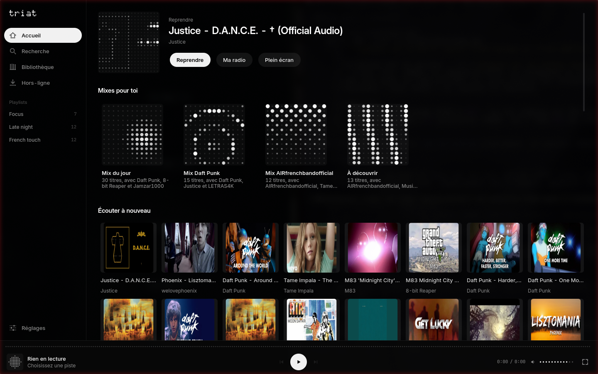
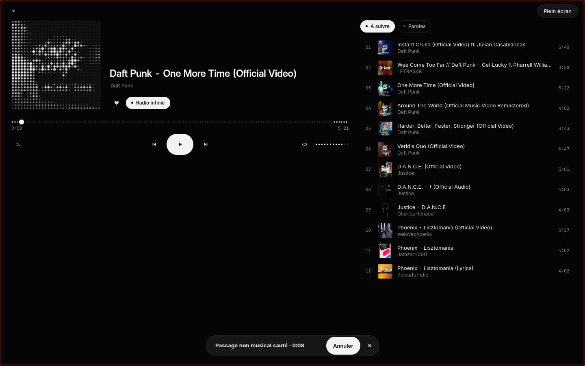
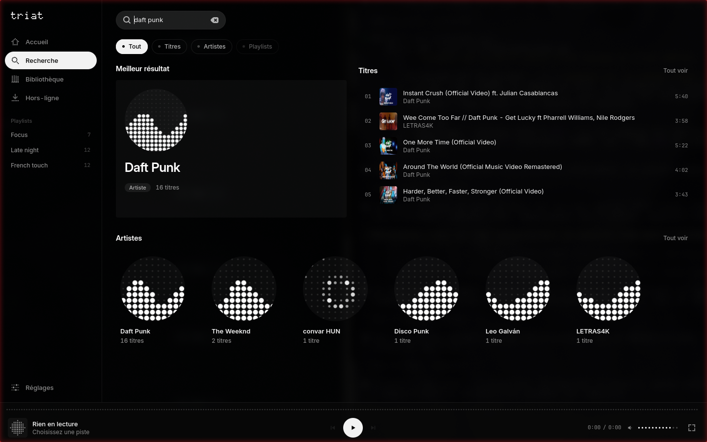
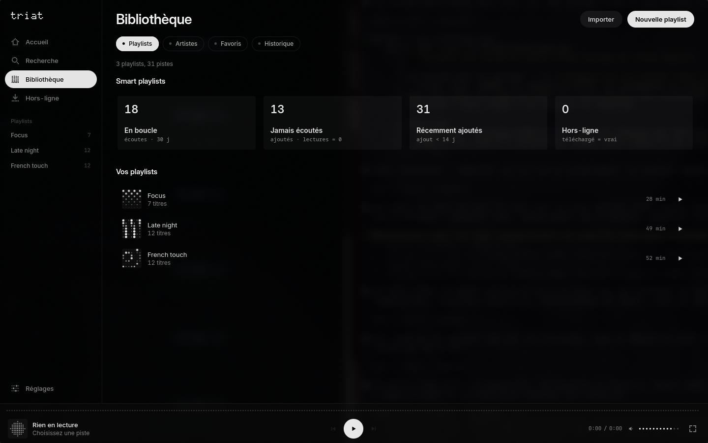
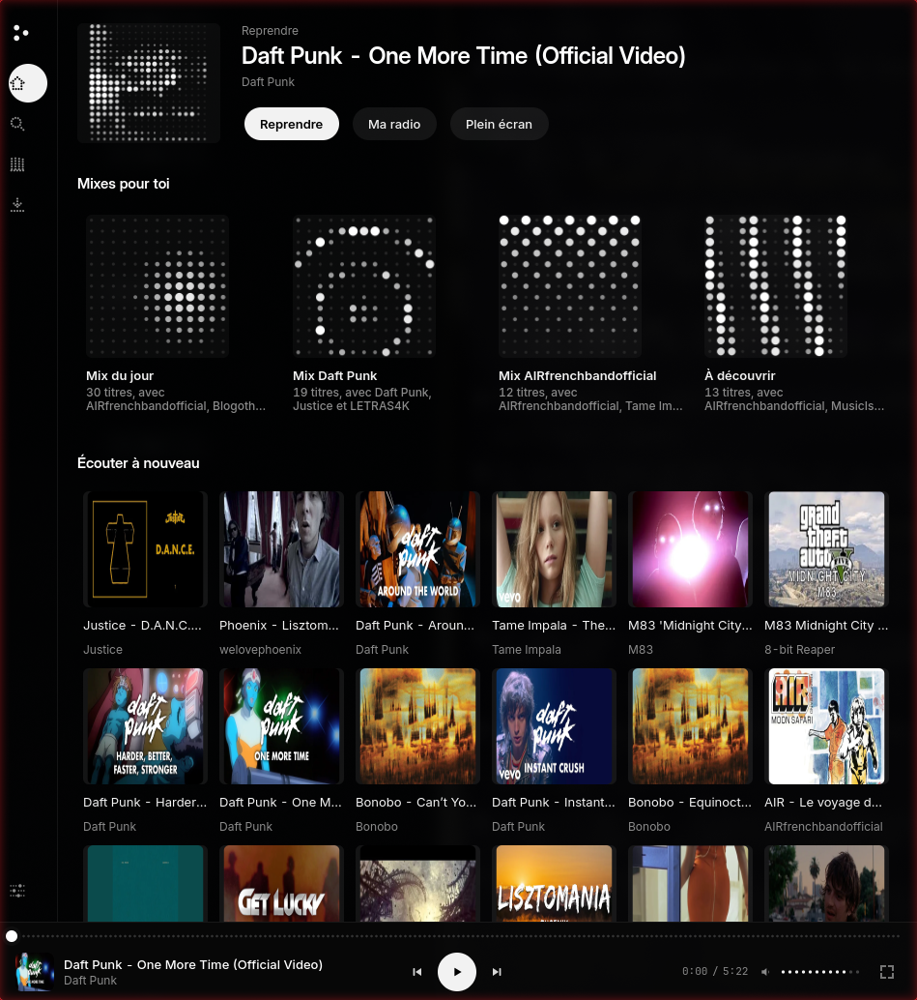

<p align="center">
  
</p>

<h1 align="center">Triat</h1>

<p align="center">
  English | <a href="README.fr.md">Français</a>
</p>

<p align="center">
  A quiet music player for Linux that plays from YouTube, keeps your library on your computer and sends nothing about you anywhere.
</p>

<p align="center">
  <a href="LICENSE"></a>
  
  <a href="https://github.com/kerstz/triat-android"></a>
  <a href="https://kerstz.github.io/triat/"></a>
</p>

<p align="center">
  
</p>

<table>
  <tr>
    <td align="center"></td>
    <td align="center"></td>
  </tr>
  <tr>
    <td align="center"></td>
    <td align="center"></td>
  </tr>
</table>

Screenshots: development version.

Triat has a [site](https://kerstz.github.io/triat/).

## What it does

- Search YouTube and play songs, with a queue, shuffle and repeat
- A radio that keeps going when the queue runs out. Suggestions fall back to your local listening history when YouTube gives nothing
- Keeps playing when you close the window
- Playlists, favourites, history and a few automatic playlists
- Import a `.txt` of YouTube links or an `.m3u` file, export playlists back
- Synced lyrics from LRCLIB
- A 10-band equaliser
- SponsorBlock: skips intros, talking and sponsor reads
- Downloads for offline listening (see the legal notice)
- A mini player, and a full screen view with the video or a dot matrix
- Media keys and `playerctl` work (MPRIS)
- Optional: use your browser cookies to get your own YouTube recommendations
- Sync with [Triat for Android](https://github.com/kerstz/triat-android) over your Wi-Fi

In development: optional SoundCloud source, off by default, see legal notice.

## Privacy

Everything stays on your computer: your library, settings and cookies live in `~/.local/share/triat` and `~/.config/triat`. Triat has no analytics, no telemetry and no crash reporting. There is no account and no Triat server.

The only hosts it contacts:

| Host | Why |
|---|---|
| `youtube.com`, `music.youtube.com` (and the Google media and image hosts they point to) | Search, playback, artwork |
| `sponsor.ajay.app` | SponsorBlock segments |
| `lrclib.net` | Synced lyrics |
| `api.listenbrainz.org` | Scrobbling, only if you turn it on |
| `soundcloud.com`, `api-v2.soundcloud.com`, `sndcdn.com` | SoundCloud search, streams and artwork, only if the SoundCloud source is on (off by default) |
| Your own phone, on your local network | Sync, only if you turn it on |

## Quick start

Install the system packages first (Arch names, Python 3.13 or newer):

```sh
sudo pacman -S python-gobject gtk4 libadwaita mpv python-cairo python-cryptography
```

Then:

```sh
git clone https://github.com/kerstz/triat.git
cd triat
bash packaging/nothing-os/install.sh --app
```

This puts the app in `~/.local/lib/triat` with its own Python environment, and adds a `triat` command and a desktop entry. Start it with `triat` or from your launcher. Your data stays in `~/.local/share/triat`.

Run `bash packaging/nothing-os/install.sh --uninstall` to remove it. Your library stays.

If you use Hyprland with the [Nothing OS dotfiles](https://github.com/0xbbuddha/dotfiles_nothing_os), run the installer without `--app` to also get the window rules, the keybinds and a small module in the top bar.

To run from the source instead:

```sh
python -m venv --system-site-packages .venv
.venv/bin/pip install -r requirements.txt
./run.sh
```

## Install

| Method | Status |
|---|---|
| Install script (above) | Works today |
| Flatpak | Build it locally with `flatpak-builder`, using [`packaging/flatpak/org.triat.Triat.yml`](packaging/flatpak/org.triat.Triat.yml). Flathub: not yet |
| AUR | Not yet. No package exists |
| Android app | APK from the [Releases](https://github.com/kerstz/triat-android/releases) page of `kerstz/triat-android` |

SHA-256 checksums: coming with the next release.

## Sync with Android

Turn it on in Settings, Synchronisation, then pair [Triat for Android](https://github.com/kerstz/triat-android) with the code shown there. Playlists, likes and listening history stay the same on both. Everything is encrypted and stays on your home network.

If a firewall is on, open TCP port 47823 and UDP port 5353 to your local network. `triat doctor` tells you what is blocked.

## Troubleshooting

- Run `triat doctor`. It checks yt-dlp, libmpv, your cookies, YouTube Music, SponsorBlock, your library and the sync.
- When YouTube changes something, playback can break. Updating yt-dlp usually fixes it: `~/.local/lib/triat/venv/bin/pip install -U yt-dlp`
- Still stuck? Open an issue and paste the output of `triat doctor`. Do not paste cookies or tokens.

## Legal notice

Triat is an independent hobby project. It is **not affiliated with, endorsed by or sponsored by Google LLC, YouTube or YouTube Music**. YouTube is a trademark of Google LLC. The development version also has an optional SoundCloud source: Triat is not affiliated with SoundCloud either, and that source stays off by default because its terms may not allow this use.

Triat does not host or distribute any music. It plays what you choose to open from public services. You are responsible for using it in line with those services' terms and with copyright law where you live.

YouTube's Terms of Service do not allow downloading content unless YouTube offers a download option for it. Only use the download feature for content you have the right to keep, such as your own uploads or freely licensed music.

This notice is not legal advice.

## Built with AI assistance

I am not a developer. I described what I wanted to an AI (Claude), it wrote most of the code, and I test the app on my own computer every day. It works well for me. Keep that in mind before you trust it with anything important. Code comments are in French.

## Contributing and security

- [CONTRIBUTING.md](CONTRIBUTING.md)
- [SECURITY.md](SECURITY.md): report vulnerabilities privately
- [CODE_OF_CONDUCT.md](CODE_OF_CONDUCT.md)
- [CHANGELOG.md](CHANGELOG.md)

## Credits

- [SponsorBlock](https://sponsor.ajay.app): segment data is fetched at run time and is licensed under [CC BY-NC-SA 4.0](https://creativecommons.org/licenses/by-nc-sa/4.0/). Triat does not redistribute it.
- [LRCLIB](https://lrclib.net): synced lyrics.
- [ListenBrainz](https://listenbrainz.org): optional scrobbling.
- Libraries and their licenses are listed in [NOTICE.md](NOTICE.md).

## License

MIT, see [LICENSE](LICENSE). The fonts in `data/fonts` are under the SIL Open Font License 1.1. Third-party components keep their own licenses, see [NOTICE.md](NOTICE.md).
